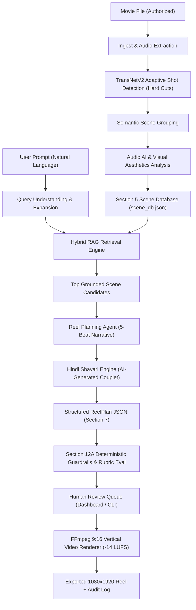

# 🎬 ReelForge: Movie RAG Reel Generation System

An AI-powered Movie Retrieval-Augmented Generation (RAG) system that analyzes full-length feature films at the scene level and generates broadcast-ready, short-form vertical videos (Instagram Reels, YouTube Shorts, 1080×1920 9:16) from natural language prompts.

---

## 🌟 Key Features

1. **Section 5 Scene Understanding & Persistent Database**:
   - Frame-accurate scene detection bounded strictly by hard cuts (no mid-shot chopping).
   - Rich metadata extraction: dialogue transcripts, visual descriptions, actions, themes, emotions, and lighting/camera moods.
   - Continuous acoustic prosody: speech rate (WPM), pitch variance, RMS energy, music intensity, and silence ratios.
   - Multi-signal scoring across **all 6 core categories**: *Sad, Action, Powerful Dialogue, Romantic, Motivational, Suspense*.
2. **Hybrid RAG Retrieval Engine (Section 6 & Question Library)**:
   - Dense semantic vector search + keyword matching + metadata filtering.
   - Section 6 weighted ranking formula:
     $$\text{Score} = 0.30 \cdot \text{Semantic} + 0.20 \cdot \text{Emotion} + 0.15 \cdot \text{Visual} + 0.15 \cdot \text{Hook} + 0.10 \cdot \text{Clarity} + 0.10 \cdot \text{Duration}$$
   - Section 4 Question Library answering (Movie understanding, scene discovery, theme search, dialogue quotes).
3. **Reel Planning Agent (Section 7)**:
   - Translates prompts like *"Create a 30-second motivational reel about overcoming failure"* into structured editing timelines.
   - 5-beat narrative flow: **Hook (0-3s) → Setback (3-9s) → Turning Point (9-19s) → Payoff (19-26s) → Closing (26-30s)**.
   - Strict timestamp grounding: all clip ranges are validated against stored scene boundaries.
4. **Original Hindi Shayari Engine (Sections 1A, 7, 13)**:
   - Original, uncopyrighted Hindi couplets (Sher) in Devanagari script matched to each reel's mood.
   - Strict guardrails: tagged with `ai_generated: true` and never presented as a movie quote.
5. **Section 2A Auto-Reel Batch Mode**:
   - Automatically assembles distinct 30-second reel plans across all 6 categories without heavy clip overlap.
   - Places all generated plans into a review queue (`reels/review_queue/`) for human approval before rendering.
6. **Section 12 & 12A Deterministic Guardrails & Rubric Judge**:
   - Deterministic checks: timestamps in bounds, dialogue exact match, scene IDs exist, schema validity, duration tolerance, and AI disclosure tags.
   - Calibrated 1-5 scale rubric evaluator (Theme match, Hook strength, Narrative coherence, Grounding check, Duration fit, Shayari quality).
7. **Single-Pass FFmpeg 9:16 Rendering Pipeline**:
   - Smart-crop reframing to 1080×1920 (9:16 vertical).
   - Loudness normalization conforming to **-14 LUFS broadcast standard**.
   - Substation Alpha (.ass) subtitles with Devanagari script support.
   - Full `.audit.json` provenance logging for publishing compliance.

---

## 🏛️ System Architecture



---

## 🚀 Quickstart & Usage

### 1. Environment Setup

```powershell
# Clone and setup virtual environment
python -m venv .venv
.\.venv\Scripts\activate
pip install -r requirements.txt
cp .env.example .env
```

### 2. Querying the Movie RAG Engine

Ask any natural language question from the Section 4 Question Library:

```powershell
# Scene Discovery
python -m reelforge.cli rag "Find the saddest scene in this movie"

# Theme / Motivation Search
python -m reelforge.cli rag "Find scenes about overcoming failure and resilience"

# Dialogue Search
python -m reelforge.cli rag "Find the most powerful dialogue scene"
```

### 3. Generating a 30-Second Reel Plan

Generate a structured Section 7 ReelPlan with a 5-beat narrative timeline:

```powershell
python -m reelforge.cli plan "Create a 30-second motivational reel about overcoming failure" --output reels/my_motivational_plan.json

# Optional: include Hindi shayari overlay
python -m reelforge.cli plan "Create a 30-second motivational reel" --with-shayari --output reels/my_plan.json
```

### 4. Evaluating Plan against Section 12A Guardrails

Verify timestamp grounding, dialogue accuracy, and rubric quality:

```powershell
python -m reelforge.cli eval reels/my_motivational_plan.json
```

### 5. Rendering the Approved Reel

Render the reel to vertical 9:16 format with -14 LUFS loudness and subtitles:

```powershell
python -m reelforge.cli render reels/my_motivational_plan.json --output reels/motivational_reel.mp4
```

### 6. Batch Auto-Reel Generation (Section 2A)

Batch-generate plans for all 6 categories into `reels/review_queue/`:

```powershell
python -m reelforge.cli auto --reels-per-cat 2
```

### 7. Interactive Web Review Dashboard

Launch the review dashboard to query scenes, prompt reels, and approve renders in the browser:

```powershell
python -m reelforge.cli serve --host 127.0.0.1 --port 8000
```
Open [http://127.0.0.1:8000/review/](http://127.0.0.1:8000/review/) in your browser (auto-detects the indexed movie).

---

## 🧪 Running Tests

Run the full automated test suite verifying Section 12A deterministic guardrails, hybrid RAG ranking, and query parsing:

```powershell
python -m unittest discover tests
```

---

## 🔒 Copyright & Rights Compliance

- **Rights Gate:** All generated reels require verified rights records in `rights_registry.json`.
- **AI Attribution:** All Hindi shayari is explicitly generated text tagged with `ai_generated: true` and never attributed to film creators or real individuals.
- **Audit Logging:** Every exported reel includes a companion `.audit.json` recording source timestamps, category, and clearance status.
