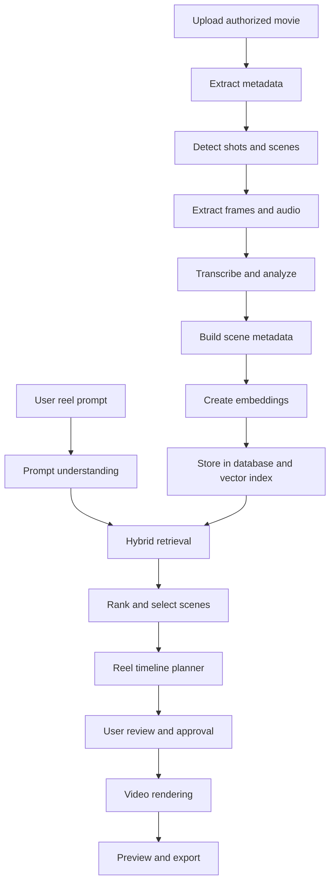

# Movie RAG Reel Generation System — Project Specification

## 1. Project Overview

Build an AI-powered Movie Retrieval-Augmented Generation (RAG) system that analyzes movies at the scene level and helps generate short-form videos (Instagram Reels, YouTube Shorts, etc.) from user prompts.

The system should retrieve relevant scenes using semantic search and movie metadata, then produce a structured reel plan that a video-editing pipeline can execute.

**Primary goal:** Turn a prompt such as *“Create a 30-second motivational reel about overcoming failure”* into a grounded scene selection and an editing plan with timestamps, dialogue, captions, music mood, and transitions.

> Use only video content the user has the rights or permission to process and publish. The system should not bypass DRM or remove watermarks from content without authorization.

---

## 1A. Project Context and Goals (updated)

- **Existing asset:** An "Auto Reels" Python script already exists. It finds sad/cinematic scenes using ffmpeg, librosa, and OpenCV and compiles 30-second 9:16 reels. **Reuse and wrap this code; do not rebuild it from scratch.** Audit it first (Phase 0).
- **Scale:** Analyze a full-length movie (about 2–2.5 hours) end to end.
- **Scene categories:** Sad, Action, Powerful Dialogue, Romantic, Motivational, Suspense.
- **Auto mode:** Automatically produce multiple 30-second vertical reels per movie (several per category), in addition to prompt-driven reels.
- **Audio/emotion analysis:** Prosody and emotion analysis of speech and audio (pitch, energy, pace, pauses, music intensity) alongside visual analysis.
- **Hindi shayari:** AI-generated Hindi shayari overlaid as captions/voiceover to match each reel's mood. Shayari is original generated text and must be labelled as such. It must never be presented as a quote from the movie.
- **Finishing:** Subtitles, transitions, background music, and effects.
- **Deployment:** Runs on the owner's own server with GPU acceleration. Modular and production-ready.
- **Purpose:** Reels are published on the owner's social media channel, with a goal of commercial monetization. Monetization raises the rights bar: only process and publish movies the owner has rights or licenses for (own, licensed, public domain, or explicit permission). Clips and music from third-party films carry copyright and takedown risk even when edited.

---

## 2. Core User Workflow

1. User uploads or imports a movie file they are authorized to process.
2. System extracts technical metadata and audio.
3. Video is segmented into scenes/shots.
4. Each scene is analyzed for visual content, characters (using non-identifying labels unless identity is known from metadata), emotions, actions, dialogue, setting, and cinematic attributes.
5. Scene metadata and embeddings are stored in a searchable database.
6. User asks for a reel in natural language.
7. RAG retrieves and ranks relevant scenes.
8. Reel Planner creates a timeline with clip ranges and a narrative flow.
9. User reviews and approves the plan.
10. Video pipeline cuts clips, adds permitted music, captions, transitions, and exports the reel.

### 2A. Auto-reel mode (batch)

1. After indexing, the system scores every scene against the six categories (sad, action, powerful dialogue, romantic, motivational, suspense).
2. For each category, it selects top candidates and assembles several distinct 30-second reel plans (no heavy clip overlap between reels).
3. For each plan, it generates a Hindi shayari matched to the mood, plus captions, music direction, and effects.
4. All plans go to the review queue. Nothing is rendered for publishing or posted without user approval.

---

## 3. Example User Requests

- “Create a 30-second motivational reel about overcoming failure.”
- “Find the saddest scenes in this movie.”
- “Make a romantic reel with a happy ending.”
- “Find the hero’s most powerful dialogue.”
- “Create a 20-second action reel with a strong hook.”
- “Find scenes about betrayal and revenge.”
- “Create a reel about loneliness using only visuals, no dialogue.”
- “Make a cinematic reel with beautiful shots and slow pacing.”
- “Create a short reel that tells a complete story.”
- “Find scenes that could inspire a life-lesson reel.”
- “Auto-generate 5 sad reels, 5 action reels, and 3 romantic reels from this movie.”
- “Create a 30-second sad reel with a Hindi shayari on top.”
- “Find the most powerful dialogue scenes and make 30-second reels with subtitles.”

---

## 4. Movie RAG Question Library

### 4.1 Movie Understanding
- What is the movie's central story?
- Who are the main characters and what are their roles?
- What motivates each character?
- What are the major conflicts?
- What are the key turning points?
- What themes and messages appear in the movie?
- What is the character's emotional journey?
- Which scenes are important to understand the story?

### 4.2 Scene Discovery
- Find the most emotional scene.
- Find the saddest scene.
- Find the happiest scene.
- Find the most intense action scene.
- Find the most suspenseful scene.
- Find the most visually striking scene.
- Find the most memorable scene.
- Find a scene that works without prior context.
- Find scenes with a strong visual hook in the first three seconds.
- Find scenes with a clear setup and payoff.

### 4.3 Emotion and Theme Retrieval
- Find scenes about motivation, hope, courage, or perseverance.
- Find scenes about heartbreak, grief, loneliness, or loss.
- Find scenes about love, friendship, family, or sacrifice.
- Find scenes about betrayal, revenge, justice, or redemption.
- Find scenes about confidence, ambition, failure, or success.
- Find scenes that convey a life lesson.
- Find scenes with a specific emotional progression (e.g. sadness to hope).

### 4.4 Dialogue Search
- Find motivational dialogues.
- Find romantic dialogues.
- Find dialogues about life, failure, success, or loneliness.
- Find philosophical or reflective dialogues.
- Find short, memorable one-liners.
- Find dialogue that fits a requested reel theme.
- Return exact dialogue, speaker label if known, language, and timestamps.
- Do not fabricate or paraphrase dialogue as an exact quote.

### 4.5 Reel Suitability
- Which scene is suitable for a 15-second reel?
- Which scene is suitable for a 30-second reel?
- Which scene can tell a story without narration?
- Which scene has an immediate hook?
- Which scene has a satisfying ending?
- Which scene is likely to evoke a strong audience reaction?
- Which scenes can be combined while preserving context?
- Which clips need subtitles or explanatory text?

### 4.5A Category Detection (the six reel categories)
- Which scenes are the saddest (emotion + slow pace + low music tempo + vocal prosody)?
- Which scenes are the most intense action (high motion + fast cuts + high audio energy)?
- Which scenes have the most powerful dialogue (emphasis, pauses, strong prosody, quotable lines)?
- Which scenes are the most romantic?
- Which scenes are motivational?
- Which scenes build the most suspense (low-key lighting, tension in score, slow build)?
- Each scene receives a 0–1 score per category plus a confidence. Scores are model estimates until validated on a labeled set.

### 4.6 Cinematic Attributes
Analyze or retrieve scenes by:
- Shot type (wide, medium, close-up, etc.)
- Camera movement (static, pan, tilt, tracking, handheld, etc.)
- Lighting and color mood
- Composition
- Motion and action
- Visual quality
- Pace
- Atmosphere
- Audio intensity
- Dialogue density

Do not claim exact technical camera attributes unless detected reliably or marked as an estimate.

---

## 5. Scene Data Schema

Store one record per scene or shot. A recommended schema:

```json
{
  "movie_id": "movie_001",
  "scene_id": "scene_0042",
  "start_time_seconds": 532.4,
  "end_time_seconds": 568.9,
  "duration_seconds": 36.5,
  "scene_summary": "A character reflects after a major setback.",
  "visual_description": "The character sits alone in a dim room...",
  "characters": ["character_01"],
  "actions": ["sitting", "looking_down", "standing_up"],
  "emotions": ["sadness", "determination"],
  "themes": ["failure", "resilience", "motivation"],
  "dialogue": [
    {
      "start_time_seconds": 540.2,
      "end_time_seconds": 545.1,
      "speaker": "character_01",
      "text": "Transcribed dialogue here.",
      "language": "en"
    }
  ],
  "audio_description": "Quiet background music with dialogue.",
  "shot_types": ["close_up", "medium"],
  "camera_motion": ["static"],
  "lighting_mood": "low_key",
  "visual_mood": ["somber", "cinematic"],
  "reel_tags": ["motivation", "emotional"],
  "category_scores": {
    "sad": 0.81,
    "action": 0.05,
    "powerful_dialogue": 0.64,
    "romantic": 0.10,
    "motivational": 0.72,
    "suspense": 0.12
  },
  "audio_features": {
    "speech_rate_wpm": 110,
    "pitch_variance": "low",
    "energy_rms": 0.18,
    "music_intensity": "low",
    "silence_ratio": 0.22
  },
  "context_requirements": "low",
  "reel_suitability": {
    "15_seconds": 0.86,
    "30_seconds": 0.92
  },
  "content_warnings": [],
  "transcript_embedding": "VECTOR_REFERENCE",
  "visual_embedding": "VECTOR_REFERENCE",
  "metadata_embedding": "VECTOR_REFERENCE"
}
```

The above is an example schema. Adapt fields and database types to the chosen stack. Avoid storing embeddings as ordinary JSON if the vector database supports native vectors.

---

## 6. RAG Retrieval Strategy

Use hybrid retrieval rather than vector search alone.

### Retrieval signals
1. Semantic similarity between user prompt and scene descriptions.
2. Keyword matching for themes, emotions, actions, and dialogue.
3. Dialogue/transcript search.
4. Visual embedding similarity.
5. Metadata filters (movie, duration, language, content restrictions).
6. Scene suitability and context requirements.

### Candidate ranking (initial heuristic)

Create a configurable ranking score, for example:

- 30% prompt/theme relevance
- 20% emotional match
- 15% visual match
- 15% hook strength
- 10% story clarity/context independence
- 10% duration fit

These weights are starting assumptions and should be tuned through evaluation—not treated as validated performance.

### Retrieval flow
1. Parse user request into theme, emotion, genre, duration, style, dialogue preference, and constraints.
2. Generate query variants (e.g. “overcoming failure”, “resilience”, “determination after setback”).
3. Retrieve candidates using semantic + keyword + transcript search.
4. Apply metadata filters.
5. Rank candidates.
6. Use a scene-selection model to assemble a coherent sequence.
7. Verify timestamps and dialogue against source metadata.
8. Return candidates with reasons and confidence scores.

---

## 7. Reel Planning Agent

The Reel Planner should produce a structured timeline. Example:

**User prompt:** “Create a 30-second motivational reel about overcoming failure.”

### Example timeline
| Reel time | Purpose | Source scene | Clip selection |
|---|---|---|---|
| 0–3 sec | Hook | Scene 42 | Strong visual or line |
| 3–9 sec | Setback | Scene 18 | Show the struggle |
| 9–19 sec | Turning point | Scene 42 | Character decides to act |
| 19–26 sec | Payoff | Scene 51 | Action or success |
| 26–30 sec | Closing | Scene 51 | Final visual + quote/caption |

The planner must not invent source timestamps. Clip ranges must be within the source scene boundaries. If a proposed timeline needs more source material, retrieve additional scenes or return a shorter plan.

### Reel plan output format
```json
{
  "request": {
    "theme": "motivation",
    "emotion": "hopeful",
    "target_duration_seconds": 30,
    "aspect_ratio": "9:16",
    "dialogue_preference": "optional"
  },
  "selected_clips": [
    {
      "movie_id": "movie_001",
      "scene_id": "scene_0042",
      "source_start_seconds": 540.2,
      "source_end_seconds": 548.2,
      "reel_start_seconds": 0,
      "reel_end_seconds": 8,
      "reason": "Strong opening hook and emotional relevance"
    }
  ],
  "captions": [],
  "shayari": {
    "language": "hi",
    "text": "AI_GENERATED_TEXT",
    "ai_generated": true,
    "placement": "overlay_or_voiceover",
    "reel_start_seconds": 22,
    "reel_end_seconds": 30
  },
  "effects": [],
  "music_direction": "Instrumental, gradual build, hopeful ending",
  "transition_notes": [],
  "render_settings": {
    "width": 1080,
    "height": 1920,
    "fps": 30
  }
}
```

---

## 8. Reel Generation Pipeline

1. Validate the selected source clips and time ranges.
2. Cut clips with FFmpeg or an equivalent media tool.
3. Reorder clips according to the approved timeline.
4. Crop or reframe for vertical video (9:16), preserving important subjects.
5. Add captions/subtitles with timing (support Devanagari and other Indic scripts with correct fonts).
5A. Add the AI-generated Hindi shayari as text overlay and/or voiceover, timed to the closing beat.
6. Add user-provided or licensed music, sound effects, and visual effects.
7. Mix audio and dialogue levels.
8. Apply transitions sparingly.
9. Add optional color adjustments.
10. Render a preview.
11. Allow user revisions.
12. Export final video and metadata.

Use a reliable rendering engine such as FFmpeg. Python libraries may be used for orchestration, analysis, and editing where appropriate.

---

## 9. Suggested System Architecture

### Services / modules
- **Frontend:** Upload movies, search scenes, prompt reels, review timeline, preview/export.
- **API:** User requests, jobs, metadata, authentication.
- **Ingestion worker:** File validation, media metadata, audio/video extraction.
- **Scene detection:** Shot boundaries and scene grouping.
- **Audio analysis:** Speech detection, transcription, music/audio descriptions.
- **Vision analysis:** Scene descriptions, actions, mood, visual attributes.
- **Metadata pipeline:** Normalize tags and timestamps.
- **Embedding service:** Generate text, transcript, and optionally visual embeddings.
- **Retrieval service:** Hybrid search and filters.
- **Reel Planner:** Select and sequence clips.
- **Render worker:** FFmpeg-based cutting, captions, audio, and export.
- **Storage:** Original media, proxy files, scene thumbnails, outputs.
- **Database:** Movies, scenes, jobs, reel plans, users.
- **Vector database:** Scene embeddings and semantic retrieval.
- **Evaluation/monitoring:** Retrieval metrics, output checks, error tracking.

### High-level flow


---

## 10. Suggested Technology Stack

Choose technologies based on budget, scale, hardware, and expertise. One possible stack:

- **Backend:** Python + FastAPI
- **Workers:** Celery, Redis, or another job queue
- **Video processing:** FFmpeg
- **Scene detection:** PySceneDetect or a comparable detector
- **Speech-to-text:** Whisper-compatible model/service
- **Vision model:** Multimodal model for scene descriptions and frame analysis
- **Embeddings:** Text embedding model; optional visual embeddings
- **Relational database:** PostgreSQL
- **Vector search:** pgvector initially; dedicated vector DB if scale requires it
- **Object storage:** Local storage for prototype; S3-compatible storage for production
- **Frontend:** React / Next.js
- **Deployment:** Docker; GPU worker only where needed

Additions for this project:

- **Existing code:** Auto Reels script (ffmpeg, librosa, OpenCV). Wrap its scene-finding and compilation logic as modules behind clean interfaces.
- **Audio/prosody:** librosa for energy, pitch, tempo, and silence features; optional speech-emotion model.
- **Hindi shayari:** An LLM prompted with the scene summary, emotion, and category. Output is reviewed by the user, stored with `ai_generated: true`, and kept separate from real dialogue.
- **Hindi/Indic transcription:** Use a Whisper-compatible model that handles Hindi and code-switched Hindi–English. Evaluate transcription accuracy per language.
- **Hardware:** Own GPU server. Use GPU for transcription, vision models, and NVENC encoding. Keep CPU-only fallbacks for development.
- **Scale note:** A 2–2.5 hour movie is large. Process in chunks with resumable jobs, and cache frames, audio features, and transcripts.

Do not lock the project to these tools; implement interfaces so components can be replaced.

---

## 11. MVP Development Roadmap

### Phase 0 — Audit existing Auto Reels script
- [ ] Inspect the current script: inputs, outputs, dependencies, hardcoded paths
- [ ] Document what works (scene detection, sad/cinematic scoring, 30s compile)
- [ ] Identify reusable functions and wrap them as modules
- [ ] Add a baseline test: one movie in, one 30s 9:16 reel out

### Phase 1 — Movie ingestion
- [ ] Upload a movie file
- [ ] Validate format and permissions
- [ ] Extract metadata
- [ ] Generate proxy video and thumbnails
- [ ] Detect scenes/shots
- [ ] Store timestamps

### Phase 2 — Scene understanding
- [ ] Extract representative frames
- [ ] Generate scene summaries
- [ ] Transcribe dialogue
- [ ] Add emotion/theme tags
- [ ] Store searchable metadata

### Phase 3 — RAG
- [ ] Create text embeddings
- [ ] Build vector search
- [ ] Add keyword/transcript search
- [ ] Implement hybrid retrieval
- [ ] Add filters for movie, duration, theme, language
- [ ] Return citations to scene IDs and timestamps

### Phase 4 — Reel planner
- [ ] Parse reel prompts
- [ ] Retrieve scene candidates
- [ ] Rank scenes
- [ ] Build timeline
- [ ] Generate captions and editing notes
- [ ] Validate timeline

### Phase 5 — Video generation
- [ ] Cut clips
- [ ] Reframe vertical video
- [ ] Add captions
- [ ] Add authorized music
- [ ] Render preview
- [ ] Export MP4

### Phase 5A — Auto-reel mode and shayari
- [ ] Score scenes for the six categories using audio, prosody, and visual signals
- [ ] Generate multiple distinct 30s reel plans per category
- [ ] Generate Hindi shayari per plan, labelled as AI-generated
- [ ] Add effects and transition presets per category
- [ ] Batch review queue for approval before final export

### Phase 6 — User experience and quality
- [ ] Build eval harness: deterministic checks, golden set, calibrated LLM judge (see 12A)
- [ ] Scene search UI
- [ ] Reel preview/timeline editor
- [ ] Re-prompt and regenerate
- [ ] Error handling and job progress
- [ ] Evaluation and monitoring
- [ ] Rights/usage workflow

---

## 12. Evaluation

Measure the system using:

### Retrieval quality
- Are the retrieved scenes relevant to the prompt?
- Are the timestamps correct?
- Does the retrieved dialogue match the source?
- Are results diverse rather than repetitive?
- Are scenes understandable without excessive context?

### Reel quality
- Does the reel match the requested emotion/theme?
- Is the hook effective?
- Does the sequence tell a coherent story?
- Are captions synchronized?
- Are audio levels acceptable?
- Does the crop preserve the subject?
- Does the final duration meet the request?

### Metrics to track
- Retrieval precision@k
- Recall@k (where labeled data is available)
- Timestamp accuracy
- Dialogue transcription error rate
- User approval rate
- Re-render rate
- Render failure rate
- Category classification accuracy (per-category precision on a labeled set)
- Shayari quality and mood match (manual rating)
- Processing time per movie-minute
- Cost per processed movie and per generated reel

Create a small manually labeled evaluation set before optimizing ranking.

---

## 12A. LLM Evaluations

Several components use LLMs or multimodal models: query parsing, scene descriptions, emotion/category labels, reel planning, and Hindi shayari. Each needs its own evaluation, because an error in one stage (for example a wrong scene description) silently corrupts retrieval and planning downstream.

### Principles
- **Deterministic checks first.** Anything that can be verified by code must not be judged by an LLM (see the table below).
- **Use LLM-as-judge only for subjective qualities,** such as mood match, hook strength, and shayari quality.
- **Calibrate judges against humans.** Manually label a small set (start with about 50–100 items), measure judge-human agreement, and only trust the judge for the criteria where agreement is acceptable.
- **Use a different model for judging than for generating** where practical, to reduce self-preference bias.
- **Prefer pairwise comparisons or fixed rubrics (1–5 scale with anchors)** over open-ended scoring. Randomize order to reduce position bias.
- **Version everything:** model name, prompt version, and eval-set version are logged with every run.
- **Treat results as estimates.** Do not claim a quality number until it is computed on a held-out set.

### What to evaluate

| Component | Check | Method |
|---|---|---|
| Dialogue in plans/captions | Text exactly matches the stored transcript | Deterministic (string match against scene records) |
| Timestamps | Clip ranges lie within scene boundaries; reel duration matches request | Deterministic |
| Scene IDs | Every cited scene exists in the database | Deterministic |
| Schema validity | Planner output parses and passes the JSON schema | Deterministic |
| Query parsing | Theme, emotion, duration, and constraints extracted correctly | Golden set of prompts with expected fields |
| Scene descriptions | Faithful to the frames and audio; no invented details | LLM judge with frames + human spot check |
| Category/emotion labels | Agree with human labels (per-category precision/recall) | Labeled set, standard metrics |
| Reel plan quality | Hook, narrative flow, mood match, context independence | LLM judge with rubric + human review |
| Hindi shayari | Fluent Hindi, correct script, matches mood, not copied from existing poems or lyrics, not presented as a movie quote | LLM judge + native-speaker review |
| Hindi transcription | Word error rate on Hindi and Hindi–English code-switched audio | Labeled audio samples |
| Safety/rights | Flags content warnings and missing rights records | Deterministic + test cases |

### Example rubric (reel plan, each scored 1–5)
1. **Theme match:** Does the sequence fit the requested theme/emotion?
2. **Hook:** Is the first 3 seconds compelling and understandable?
3. **Coherence:** Does the order make sense without the full movie?
4. **Grounding:** Is every clip, quote, and timestamp supported by stored records? (Any failure here is an automatic fail.)
5. **Duration/format fit:** Is the target length and 9:16 framing respected?

### Example golden test case
```json
{
  "case_id": "eval_001",
  "prompt": "Create a 30-second sad reel with a Hindi shayari",
  "movie_id": "movie_001",
  "expected": {
    "category": "sad",
    "target_duration_seconds": 30,
    "aspect_ratio": "9:16",
    "shayari_language": "hi"
  },
  "must_pass": ["timestamps_in_bounds", "dialogue_exact_match", "shayari_labelled_ai_generated"]
}
```

### Process
1. Build the eval set from real outputs: failures, edge cases, and a mix across all six categories and Hindi/English content.
2. Run the deterministic checks on every plan in CI and in production.
3. Run LLM-judge evals on the golden set whenever a prompt, model, or ranking weight changes. Block the change if grounding checks fail or key scores regress.
4. Sample a few production reels each week for human review, and add confirmed failures to the eval set.
5. Track judge cost and latency; use a smaller judge for routine runs and a stronger one for release checks.

---

## 13. Reliability and Guardrails

- Ground every selected clip in stored scene records.
- Never invent timestamps or exact dialogue.
- Clearly label uncertain scene descriptions and model-generated inferences.
- Check clip boundaries and output duration.
- Avoid inappropriate content based on user settings and platform requirements.
- Respect copyright, licenses, privacy, and distribution permissions.
- Require user review before publishing or posting.
- Keep processing jobs resumable and idempotent where practical.
- Log model versions and processing metadata.
- Secure uploads and apply file-size, format, and malware checks.
- Label AI-generated shayari as AI-generated. Never present it as movie dialogue or attribute it to a real person.
- Before monetized publishing, require a rights check per movie and per music track. Store the license or permission record with the movie.
- Run the deterministic grounding checks in section 12A on every plan before it reaches the review queue.
- Keep category scores and emotion labels marked as estimates, and tune them on a manually labeled set.

---

## 14. First MVP Scope

For the first working version, keep it simple:

1. Process one movie at a time.
2. Detect scenes and store timestamps.
3. Generate scene descriptions and dialogue transcripts.
4. Search scenes using a text prompt.
5. Return the top 5–10 scene matches with timestamps and reasons.
6. Let the user select scenes.
7. Generate a 15- or 30-second vertical reel.
8. Add subtitles and user-provided/licensed background audio.
9. Render an MP4 preview.

Next after the MVP: auto-reel batch mode with category scoring, Hindi shayari, and effects (Phase 5A).

Build reliable scene retrieval first. Add automated cinematic editing and advanced visual ranking after the retrieval pipeline is working.

---

## 15. Definition of Done

The MVP is considered functional when a user can:

- Upload a movie they are authorized to process.
- Wait for scene indexing to complete.
- Ask a natural-language reel request.
- Receive relevant scenes with accurate timestamps and explanations.
- Approve or adjust the scene sequence.
- Generate and preview a vertical reel.
- Export the finished video.

---

## 16. Instructions for the AI Coding Agent

Implement this project incrementally. An Auto Reels script already exists: read it first and reuse its working logic. Start by inspecting the current repository, documenting its existing structure, and identifying what already works. Do not overwrite working code without understanding it.

Before coding each phase:
1. Propose the implementation plan.
2. Identify files and components to create or modify.
3. Explain dependencies and configuration.
4. Implement the smallest testable milestone.
5. Run tests and report actual results.
6. Document setup and usage.

Use environment variables for secrets and configuration. Include a `.env.example`, Docker configuration where useful, clear README instructions, logging, error handling, and tests.

Do not claim a feature is implemented unless it exists and has been tested. If a requirement cannot be completed, explain the blocker and provide the next step.
